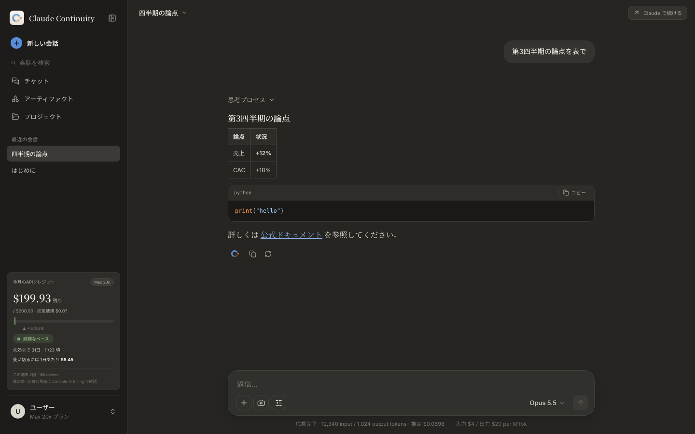
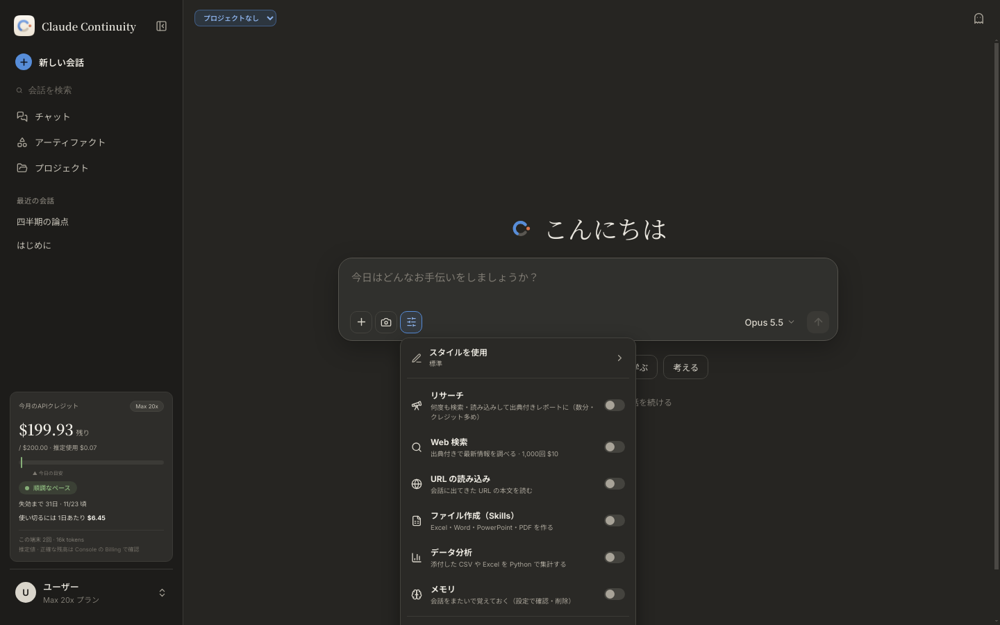
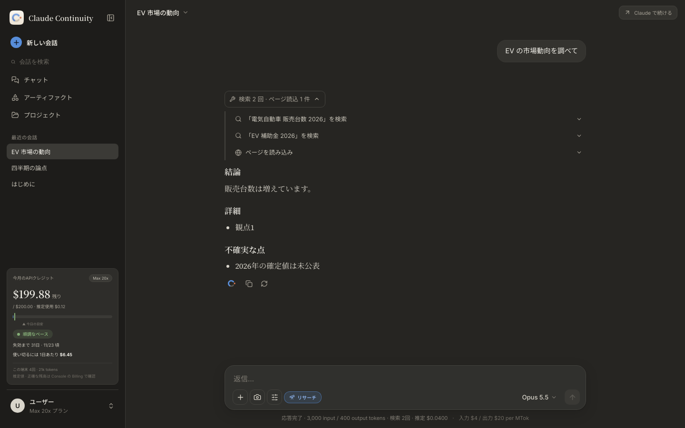
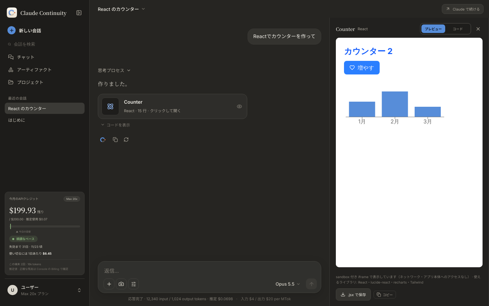
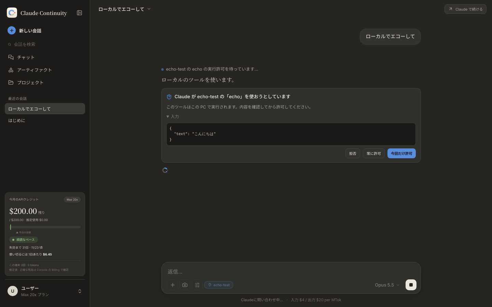
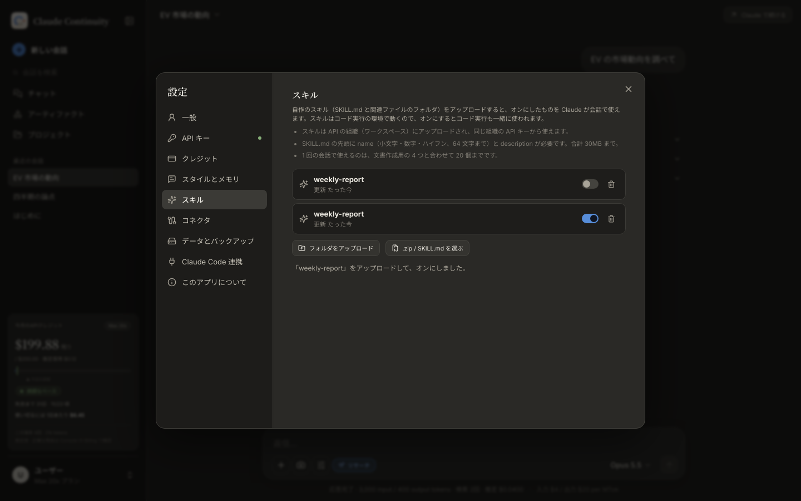
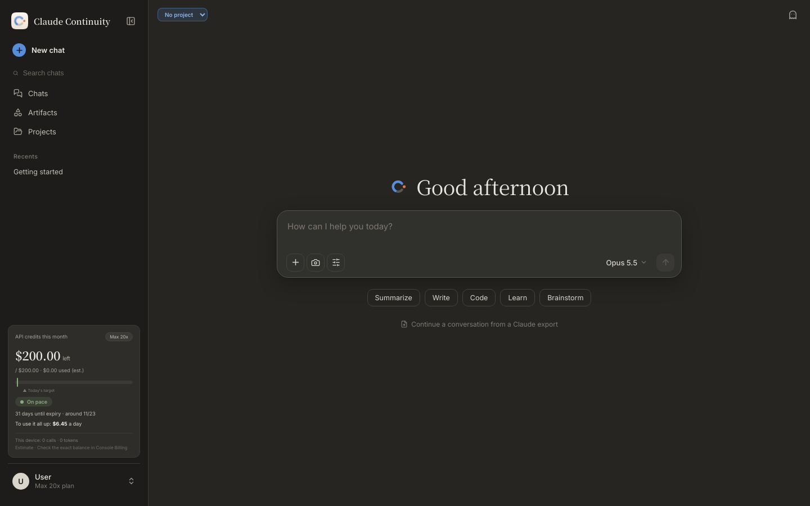

# Claude Continuity

[English](README.md) | 日本語

Claude の会話を **Anthropic API** で続けるためのデスクトップアプリです（Windows / macOS / Linux、Electron + React）。
Max プランなどに付く**月間 API クレジット**を、Claude アプリに近い使い心地で使い切ることを目的にしています。

> Anthropic の公式製品ではありません。Claude のロゴやデザインは使っていません。



<sub>スクリーンショットはすべて v0.1.6 時点の画面を、テスト用のモック API に接続して撮ったものです（回答の中身はダミーです）。</sub>

## できること

**会話**
- ストリーミング表示、思考プロセスの表示、停止、再生成（バージョン切り替え）、編集して再送信
- 途切れた返信の続きを生成、拒否時の案内、ツールの実行ステップの表示
- Markdown、表、コードのハイライト、数式（KaTeX）
- 添付：画像、PDF、テキスト、コード。表計算ファイルはコード実行で読みます。ボタン、ドラッグ＆ドロップ、貼り付けのどれでも追加できます。
- モデルと思考の深さ（`effort`）の選択。選べるモデルは API キーで使えるモデルの一覧から自動で取得します。
- スタイル：標準・簡潔・詳細・説明的に加え、カスタムスタイルを複数作れます。文章サンプルから作ることもできます。
- 自動タイトル、会話の検索、スター、チャット一覧ページ、シークレットチャット
- Claude の会話エクスポート（JSON / ZIP）の読み込み

**ツール**（会話ごとにオン・オフ）
- **リサーチ**：検索とページの読み込みを繰り返し（各最大 20 回）、結論・観点ごとの詳細・不確実な点の順に出典付きでまとめます。
- Web 検索、Web ページの取得（番号付きの出典）
- コード実行、ファイル作成（Excel / Word / PowerPoint / PDF、Anthropic の Skills）
- **独自スキル**：設定 →「スキル」から、SKILL.md のあるフォルダや .zip を Skills API にアップロードし、オンにしたものを会話で使います（コード実行の環境で動きます）
- メモリ（この PC に保存）
- 過去の会話の検索
- コネクタ（MCP サーバー）。詳しくは[下の節](#コネクタmcp-サーバー)を参照してください。

**アーティファクト**
- HTML、SVG、Markdown ドキュメント、Mermaid 図、**React コンポーネント**をプレビューできます。
  - プレビューは sandbox 付きの iframe で表示し、ネットワークに接続しません。
  - React には lucide-react、recharts、Tailwind を同梱しています。
- バージョン切り替え、保存、一覧ページ

**プロジェクト**
- 指示とナレッジファイル（キャッシュされます）、プロジェクト単位のメモリ
- テキストのナレッジが大きくなると（会話に使える量の半分を超えると）、全文を送る代わりに Claude が必要な箇所を検索して読みます（日本語にも対応したキーワード検索）

**そのほか**
- **Claude アプリへの引き継ぎ**：要約または全文を、Claude Desktop の入力欄に下書きとして入れます。
- **API クレジットの管理**：推定残額、失効までの日数、1日あたりの目安、ペースの警告を表示します。Console の残高から補正することもできます。
- **日本語・英語の UI**：設定 → 一般 → 言語 で切り替えます。英語の文言は、Claude の英語 UI に合わせています。
- **テーマとフォント**：ダーク / ライト / システム、チャットのフォント
- **バックアップと復元**、会話の書き出し（JSON / HTML）
- **アプリ内アップデート**：新しい版を通知し、ボタンでダウンロードして再起動します。
- **呼び出しショートカット**：ほかのアプリを使っていても、`Ctrl/⌘ + Alt/⌥ + Space`（設定 → 一般で変更・オフ）でアプリを前面に出し、新しい会話を始めます。
- **スクリーンショットの添付**：入力欄のカメラボタンで、マウスのある画面を取り込んで添付します（macOS は「画面収録」の許可が必要）。
- **返信の通知**、キーボードショートカット（`Ctrl/⌘ + Shift + ?` で一覧）

| ツールメニュー（リサーチ） | リサーチの結果と調べた手順 | React アーティファクト |
|---|---|---|
|  |  |  |
| **ローカル MCP の実行確認** | **独自スキル** | **英語 UI** |
|  |  |  |

## 料金についての注意

**Claude の Pro / Max のサブスクリプション枠と、API クレジットは別物です。** このアプリは API キーで Anthropic API を呼ぶので、料金は API の組織の請求とクレジットに付きます。Claude アプリやサブスクリプションの使用量は消費しません。

Max プランなどの月間 API クレジットは請求サイクルの終わりに失効します。最新の条件は Anthropic の案内で確認してください。

## インストール（Windows）

1. [Releases](https://github.com/kajisho5/claude-continuity/releases) から `Claude-Continuity-Setup-<version>.exe` をダウンロードして実行します。
2. インストーラーには署名がありません。SmartScreen の警告が出たら「詳細情報」→「実行」を選んでください。
3. 初回起動時の設定で、プラン、クレジットの付与日、API キーの順に入力します。API キーは接続テストをしてから保存します。

API キーは [Anthropic Console](https://console.anthropic.com/) で発行します。

## インストール（macOS）

1. [Releases](https://github.com/kajisho5/claude-continuity/releases) から、Mac に合ったファイルをダウンロードします。
   - Apple シリコン（M1 以降）：`Claude-Continuity-<version>-arm64.dmg`
   - Intel：`Claude-Continuity-<version>-x64.dmg`
2. dmg を開き、アプリを「アプリケーション」フォルダにドラッグします。
3. v0.1.5 以降の Mac 版は Developer ID で署名し、Apple の公証を通しています。そのまま開けて、アプリ内のアップデートも使えます。
   - v0.1.4 以前の Mac 版（アドホック署名）は自動更新できないので、一度だけ手動で入れ替えてください。

## コネクタ（MCP サーバー）

設定 → コネクタ で登録し、会話ごとに入力欄の「ツール」メニューからオンにします。

| 種類 | 仕組み | 注意 |
|---|---|---|
| リモート（URL） | API の MCP connector（beta）が、`https://` で公開されたサーバーに直接接続します。 | アクセストークンは暗号化して保存します。やり取りは Anthropic の標準のデータ保持の対象です。 |
| ローカル（コマンド） | この PC でサーバーを起動し（stdio）、ツールを Claude に渡します。書き方は Claude Desktop の `mcpServers` と同じです。 | ツールを実行する前に、毎回「今回だけ許可 / 常に許可 / 拒否」を確認します。環境変数は暗号化して保存します。コマンドはあなたの権限で動くので、信頼できるものだけを登録してください。 |

「**Claude Desktop から読み込む**」を押すと、`claude_desktop_config.json` のサーバーを一括で登録できます。設定ファイルの場所は[公式ドキュメント](https://modelcontextprotocol.io/docs/develop/connect-local-servers)に従っています。

- Windows：`%APPDATA%\Claude\claude_desktop_config.json`
- macOS：`~/Library/Application Support/Claude/claude_desktop_config.json`

## Claude Code / Claude Desktop から API に作業を任せる（同梱の MCP サーバー）

アプリには MCP サーバー（`dist-mcp/server.js`）が入っています。これを Claude Code や Claude Desktop に登録すると、重い資料の読み込みや長い推論を API クレジットで処理し、要約だけを会話に返せます。登録用のコマンドと JSON は、設定 →「Claude Code 連携」で読ませてよいフォルダを選ぶと生成されます。

| ツール | 内容 |
|---|---|
| `delegate_task` | 指示とファイルパスを受け取り、サーバーがファイルを直接読んで処理し、要約だけを返します。事前に `count_tokens` で最悪額を見積もり、上限を超えるときは実行しません。 |
| `credit_status` | 今月の推定残額、失効日、1日あたりの目安を返します。 |

| 環境変数 | 内容 |
|---|---|
| `ANTHROPIC_API_KEY` | この用途専用のキー。MCP の設定に平文で残るので、期限と支出上限を付けたキーを推奨します。 |
| `CONTINUITY_MCP_ROOTS` | 読み込みを許可するフォルダ（Windows は `;`、macOS / Linux は `:` 区切り） |
| `CONTINUITY_DATA_DIR` | アプリのデータフォルダ。利用記録とクレジット設定の共有に使います。 |
| `CONTINUITY_MCP_MODEL` | 既定のモデル（既定 `claude-opus-5-5`） |
| `CONTINUITY_MCP_MAX_USD_PER_CALL` | 1回あたりの費用の上限（既定 2） |
| `CONTINUITY_MCP_LANG` | 出力の言語（`ja` / `en`）。未指定なら OS の言語に合わせます。 |
| `ELECTRON_RUN_AS_NODE=1` | アプリ本体を Node として動かします。Node.js をインストールしなくても使えます。 |

## データとプライバシー

- 会話、プロジェクト、添付、メモリ、設定、利用記録は、この PC のユーザーデータフォルダにだけ保存します。クラウドには同期しません。
- API キー、コネクタのトークン、ローカル MCP の環境変数は、OS の安全な保存領域（Electron `safeStorage`）で暗号化します。
- 会話を続けるときは、モデルの入力上限に収まる範囲の履歴と添付を Anthropic API に送ります。
- アプリに表示する残額は、ローカルの記録から出した**推定値**です。正確な残高は Console の Billing で確認してください。

### バックアップと引っ越し

設定 →「データとバックアップ」から、すべてのデータを ZIP 1つに書き出せます。

- API キーは含まれません。PC ごとに暗号化しているためです。復元先の PC で設定し直してください。
- 復元すると、今のデータは置き換わります。置き換える前の状態は `backups/before-restore-*.zip` に自動で保存されます。

## 既知の制限

- **まだ実機で確認できていないこと**：本物の API キーでの動作、Windows インストーラー、実際の Claude Desktop への引き継ぎ、`npx` を使う実際のローカル MCP サーバー。ここまでのテストは、Linux 上でモック API を使って行っています。アプリ内アップデートは、Linux の AppImage とローカルの配信元で「確認 → ダウンロード → 再起動 → 新しい版に入れ替わる」まで通しました（Windows と macOS のインストーラーでは実機未確認）。
- **会話エクスポートの読み込み**：形式の推定に頼っているので、うまく読めない場合があります。エクスポートに含まれる添付、アーティファクト、ツールの呼び出しは再現しません。
- **長い会話**：入力上限を超える古い履歴は省きます（画面で知らせます）。自動での要約はしません。
- **音声入力**：アプリ独自の機能はありません。OS の音声入力がそのまま使えます（Windows は `Win + H`、macOS は「音声入力」のショートカット）。
- **ナレッジの検索**：意味の近さではなくキーワードで探します。PDF のナレッジは検索の対象外で、これまでどおり全文を送ります。
- **API ではできないこと**：claude.ai との履歴の同期、claude.ai アカウント側のメモリの利用。
- Windows のインストーラーには署名がありません。

## 開発

必要なもの：Node.js 20 以上

```bash
npm install
npm run dev      # Vite + Electron（開発モード）
npm test         # 単体テスト（vitest）
npm run build    # 型チェック（renderer / electron）とビルド
npm start        # ビルド済みのアプリを起動
```

パッケージ作成：`npm run dist:win` / `npm run dist:mac` / `npm run dist:linux`

構成：

| フォルダ | 内容 |
|---|---|
| `src/` | 画面（React 19、Tailwind CSS v4） |
| `src/i18n/` | UI の文言。`ja` が基準で、`en` は型でそろえています。 |
| `src/artifact-runtime/` | React アーティファクトのランタイム |
| `electron/` | main プロセス：API 呼び出し、保存、コネクタ、アップデート |
| `mcp/` | 同梱の MCP サーバー |

## リリース（メンテナー向け）

1. `package.json` の `version` を上げてコミットします。
2. 次のどちらかでタグを付けます。
   - `git tag v<version> && git push origin v<version>`
   - GitHub の Actions で「Package installers」を実行し、`release_tag` に `v<version>` を入れます。選んだブランチの先頭にタグを付けてリリースまで行います。
3. `.github/workflows/release.yml` が下書きのリリースを作り、Windows と macOS を並行してビルドしてアップロードします。Windows のビルドが成功したら公開します。タグと `version` が一致しないと失敗します。
   - Windows：`.exe`、`.blockmap`、`latest.yml`
   - macOS：arm64 と x64 の `.dmg` と `.zip`、`latest-mac.yml`
4. インストール済みのアプリは、起動の約15秒後と、その後6時間ごとに `latest.yml` を確認し、新しい版を案内します。

**macOS の署名と公証**：次のどちらかの secret がそろうと、Developer ID で署名・公証され、Mac 版も自動で更新できるようになります（[electron-builder の公証の説明](https://www.electron.build/docs/notarization)）。

- **runway の共有証明書（このリポジトリの設定）**：`kajisho5/runway` の `repos.txt` にこのリポジトリを載せてあるので、runway の sync-secrets が `ASC_KEY_ID`・`ASC_ISSUER_ID`・`ASC_KEY_P8_BASE64`・`APPLE_TEAM_ID`・`MATCH_GIT_TOKEN` を配ります。リリース時に hanger の Developer ID 証明書を読み、runway の `scripts/asc.py` で鍵を復号して署名し、同じ App Store Connect API キーで公証します。リリースのたびに runway を操作する必要はありません。
- **自前の証明書**：下の表の secret を設定します。証明書には Apple Developer Program（有料）への登録が必要です。

| secret | 内容 |
|---|---|
| `CSC_LINK` / `CSC_KEY_PASSWORD` | 「Developer ID Application」証明書（.p12）を base64 にしたものと、そのパスワード |
| `APPLE_API_KEY` / `APPLE_API_KEY_ID` / `APPLE_API_ISSUER` | App Store Connect の API キー（.p8 を base64 にしたもの）と、その ID |
| または `APPLE_ID` / `APPLE_APP_SPECIFIC_PASSWORD` | Apple ID と App 用パスワード |
| `APPLE_TEAM_ID` | チーム ID |

自動更新は Releases を認証なしで読みます。そのため、配布先のリポジトリは公開されている必要があります。配布専用のリポジトリを使う場合は、Actions の変数 `RELEASES_REPO` と secret `RELEASES_TOKEN` を設定してください。

