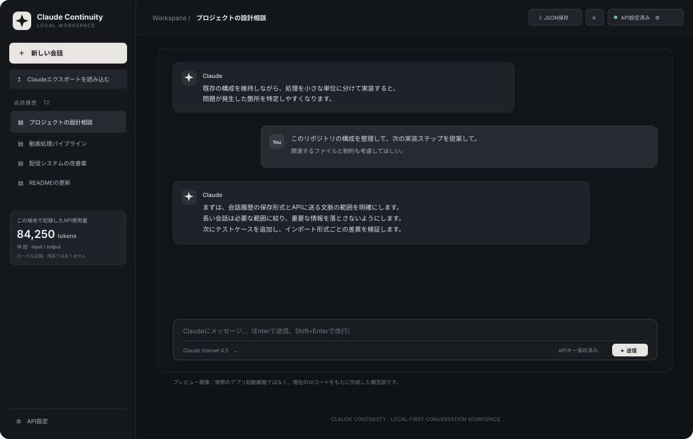

# Claude Continuity

A local-first Electron desktop app for importing Claude conversation exports and continuing selected conversations through the Anthropic Messages API.

## Implemented in the repository

## GUI preview



> This is a conceptual preview based on the current UI source, not a screenshot of a successfully built or running application. The app has not yet been build-verified.


- Electron + React + TypeScript desktop application
- Import Claude conversation exports in JSON or ZIP format (best-effort parser for common export layouts)
- Continue imported conversations through the Anthropic API
- Choose between configured Claude models in the composer, plus the thinking depth (`effort`) each model supports
- Streamed replies with Markdown rendering (tables, highlighted code with copy buttons), a summarized-thinking panel, and a stop button
- Attachments (images, PDFs, text/code; spreadsheets via code execution) by button, drag and drop, or paste
- Projects with custom instructions and knowledge files, response styles, and optional memory (`memory_20250818`, stored locally)
- Tools per conversation: web search and URL fetch with numbered sources, Skills (Excel/Word/PowerPoint/PDF creation with download), and data analysis via code execution
- Regenerate (with version switching), edit-and-resend, automatic titles, sandboxed HTML/SVG artifact preview, and automatic prompt caching
- Bundled MCP server (`delegate_task`, `credit_status`) so Claude Code / Claude Desktop can hand heavy reading and reasoning to the API credit and get back only a summary
- Monthly API credit tracker for Max/Team plans: first-run setup (plan → grant day → API key with connection test), estimated remaining credit, expiry countdown, daily budget, and pace warnings; optional calibration from the Console balance
- Store conversation history and API usage records locally
- Search conversations by title and message text
- Export an individual conversation to JSON and delete conversations
- Store the Anthropic API key using Electron `safeStorage`
- Windows NSIS, macOS DMG, and Linux AppImage packaging configuration
- GitHub Actions build and manual Windows packaging workflows

## Important billing distinction

**Claude Pro/Max subscription usage is not the same as Anthropic API credits.** This application calls the Anthropic API with an API key, so requests are billed under the API organization's billing and credit terms. It does not consume unused Claude Max subscription usage, and it does not read or spend a Claude app/Max allowance. Check the current Anthropic Console and Claude plan terms before using it.

## Data and privacy

- Conversation history and the local token ledger are stored under Electron's user-data directory.
- The API key is encrypted with Electron `safeStorage` where supported.
- When continuing a conversation, the selected recent message context is sent to Anthropic's API.
- Exported conversations may contain private information; keep export files secure.
- API usage shown in the app is a local record of successful requests, not a real-time credit balance or exact cost estimate.

## バックアップと引っ越し

設定 →「データとバックアップ」から、会話・プロジェクト・添付ファイル・メモリ・設定・使用量の記録を 1 つの ZIP に書き出せます。

- API キーは含まれません。キーはこの PC 専用の暗号化（`safeStorage`）で保存しているためです。復元先の PC で設定し直してください。
- 復元すると現在のデータは置き換わります。置き換える前の状態は、ユーザーデータフォルダの `backups/before-restore-*.zip` に自動で保存されます。
- データはこの PC のユーザーデータフォルダにだけ保存されます。クラウドには同期しません。フォルダの場所は同じ画面に表示されます。

## Known limitations

- The export parser is best-effort; Claude export formats and attachment types vary.
- Images, files, artifacts, tool calls, and other rich message content are not faithfully reconstructed.
- Long context is truncated to a recent character-bounded suffix; automatic summarization and model-specific token budgeting are not implemented.
- API credit balance and expiration are not queried.
- Windows/macOS installers have packaging configuration but are not release-verified.
- The repository has not been validated by a successful build in this environment. Do not treat the application as tested until CI succeeds and a real export is exercised.

## Requirements

- Node.js 20+
- An Anthropic Console API key with API access and available API credits

## Development

```bash
npm install
npm run dev
```

## MCP 連携（Claude Code / Claude Desktop から API に作業を任せる）

`npm run build` で `dist-mcp/server.js` が作られます。アプリの「API設定 › MCP 連携」で、読ませてよいフォルダを選ぶと登録コマンドを生成できます。

| ツール | 内容 |
|---|---|
| `delegate_task` | 指示とファイルパスを受け取り、サーバーがファイルを直接読んで Messages API で処理し、要約だけを返す。事前に `count_tokens` で費用を見積もり、1回の上限を超えると実行しない |
| `credit_status` | アプリと MCP の利用記録から、今月の推定残額・失効日・1日の目安を返す |

| 環境変数 | 内容 |
|---|---|
| `ANTHROPIC_API_KEY` | この用途専用のキー（MCP 設定に平文で残るため、期限と支出上限のあるワークスペースのキーを推奨） |
| `CONTINUITY_MCP_ROOTS` | 読み込みを許可するフォルダ（Windows は `;`、macOS/Linux は `:` 区切り） |
| `CONTINUITY_DATA_DIR` | アプリのデータフォルダ（利用記録とクレジット設定の共有に使う） |
| `CONTINUITY_MCP_MODEL` | 既定のモデル（既定 `claude-opus-5-5`） |
| `CONTINUITY_MCP_MAX_USD_PER_CALL` | 1回あたりの費用上限（既定 2） |
| `ELECTRON_RUN_AS_NODE=1` | アプリ本体の実行ファイルを Node として使う（Node.js のインストール不要） |

## Tests

```bash
npm test
```

## Type-check and production build

```bash
npm run build
npm start
```

## ダウンロード（Windows）

[Releases](https://github.com/kajisho5/claude-continuity/releases) ページから `Claude Continuity Setup <version>.exe` をダウンロードして実行します。インストーラーには署名がないため、Windows SmartScreen の警告が出たら「詳細情報」→「実行」を選んでください。

### リリースの公開手順（メンテナー向け）

1. `package.json` の `version` を上げてコミットします。
2. `git tag v<version> && git push origin v<version>` を実行します。
3. `.github/workflows/release.yml` がインストーラーをビルドし、テストを実行してから同じタグのリリースにアップロードします。タグと `package.json` の version が一致しないと失敗します。
4. インストール済みのアプリは、起動の約15秒後に Releases の `latest.yml` を確認します。新しい版があれば画面上部に案内を出し、ボタンを押したときだけダウンロードと再起動を行います（設定 →「このアプリについて」からも確認できます）。

> 自動更新は Releases を認証なしで読みに行くため、リポジトリが公開されている必要があります。非公開のままだと「更新を確認できませんでした」と表示されます。その場合は新しいインストーラーを手動で入れ直してください。

## Package locally

```bash
npm run dist:win
npm run dist:mac
npm run dist:linux
```
