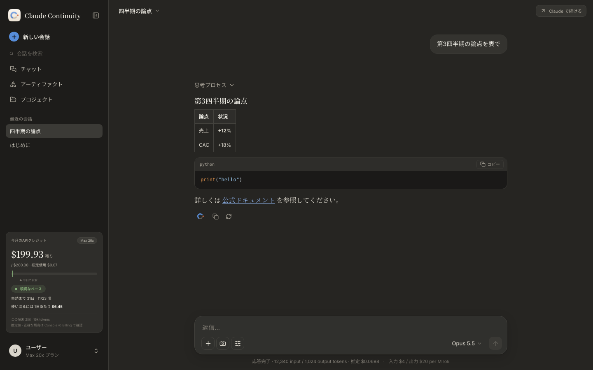
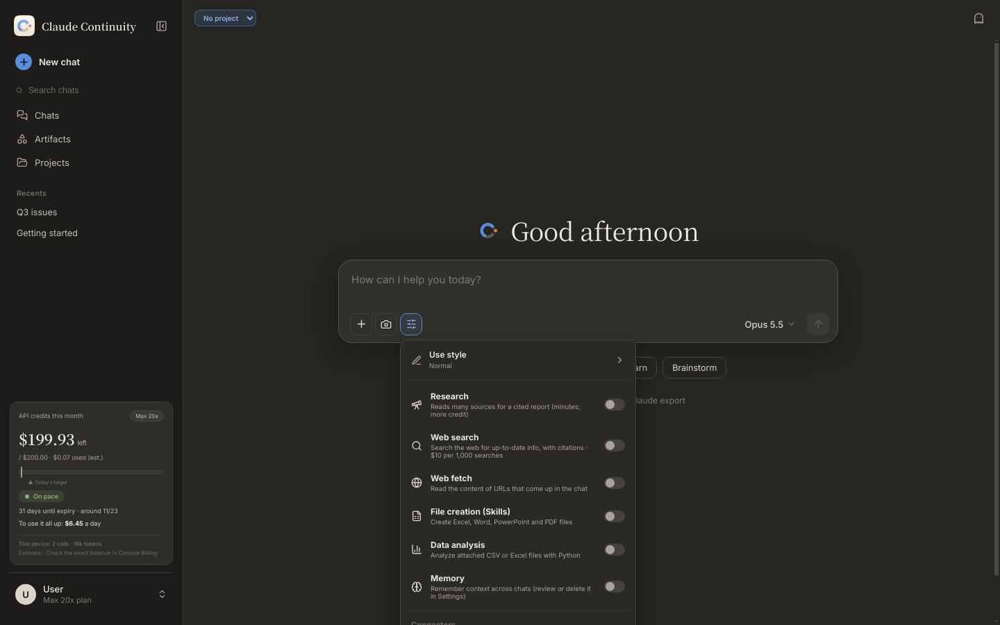
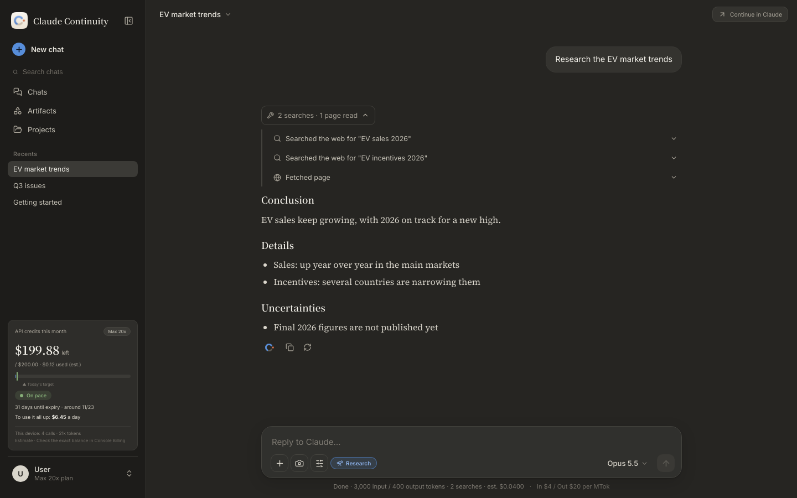
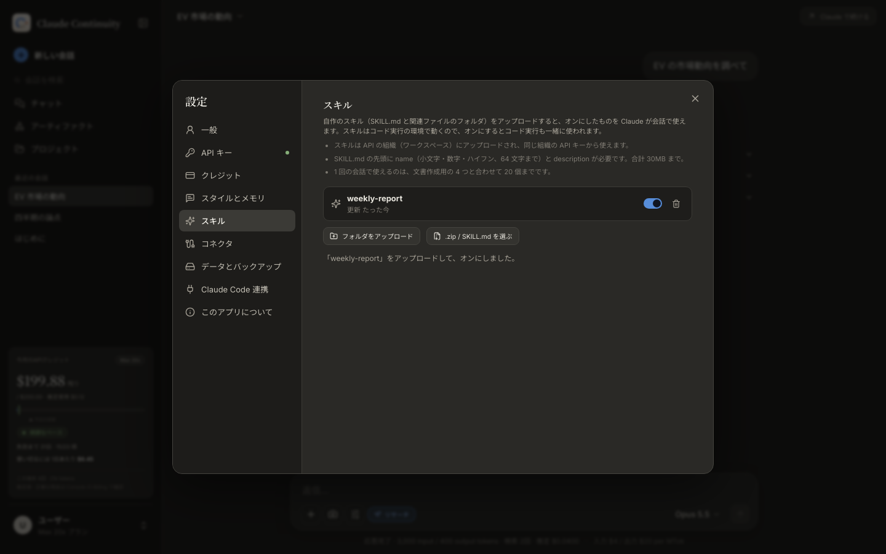

# Claude Continuity

English | [日本語](README.ja.md)

A desktop app (Windows / macOS / Linux, Electron + React) for continuing Claude conversations through the **Anthropic API**. It is built to spend the **monthly API credit** that comes with plans such as Max, with an experience close to the Claude apps.

> Not an official Anthropic product. It does not use Claude's logo or design.



<sub>All screenshots show v0.1.6, taken against a mock API used for testing (the replies are placeholders).</sub>

## Features

**Chat**
- Streaming replies, thought process, stop, retry (with version switching), edit and resend
- Continue cut-off replies, notice on refusals, a log of the tool steps Claude took
- Markdown, tables, highlighted code, math (KaTeX)
- Attachments: images, PDFs, text and code; spreadsheets are read through code execution. Add them with the button, drag and drop, or paste.
- Model and thinking effort (`effort`) picker; the model list comes from what your API key can use
- Styles: Normal, Concise, Detailed and Explanatory, plus any number of custom styles, which can also be made from a writing sample
- Automatic titles, chat search, stars, a chat history page, incognito chats
- Import Claude conversation exports (JSON / ZIP)

**Tools** (on or off per chat)
- **Research**: repeated web searches and page reads (it stops continuing once about 20 of either have been used), then a cited report: conclusion, details per angle, and remaining uncertainties
- Web search and web fetch (numbered sources)
- Code execution and file creation (Excel / Word / PowerPoint / PDF, Anthropic's Skills)
- **Custom Skills**: upload a folder with SKILL.md, or a .zip, to the Skills API from Settings → Skills; Claude uses the ones you turn on (they run in the code execution environment)
- Memory (stored on this computer)
- Search past chats
- Connectors (MCP servers); see [below](#connectors-mcp-servers)

**Artifacts**
- Preview HTML, SVG, Markdown documents, Mermaid diagrams and **React components**
  - Previews run in a sandboxed iframe with no network access
  - lucide-react, recharts and Tailwind are bundled for React
- Versions, saving, and an artifacts page

**Projects**
- Instructions and knowledge files (cached), and per-project memory
- When the text of the knowledge (text files and the text layer of PDFs) grows past half of what a chat can hold, Claude searches it for the passages it needs instead of receiving it whole (keyword search that also handles Japanese)

**More**
- **Handoff to the Claude apps**: puts a summary or the full transcript into Claude Desktop's message box as a draft
- **API credit tracker**: estimated balance, days until expiry, a daily target and pace warnings; can be calibrated from the Console balance. In the last week, when the credit is going unused, it suggests ways to use it (summarize past chats with Batch, start a research task, hand work over from Claude Code)
- **Batch (half price)**: turn on "Batch" in the tools menu and that chat's messages go through the Message Batches API at 50% off. The reply arrives later (usually within an hour, at most 24 hours) in place of a waiting card, with a notification; the Batch page lists every request. Tools that run on this computer (memory, past-chat search, local MCP servers) can't be used with Batch
- **Cost estimate and spending limits**: under the message box, the input of the next message is counted with the free `count_tokens` and priced. Settings → Credit → Spending limits sets a per-message and a daily limit, and whether to ask or not send when a message would go over
- **Long chats**: the earlier messages that no longer fit the model's input are summarized (with the API's compaction where the model supports it, otherwise a short summary written by the cheapest Haiku) and sent in their place; the newest turns are sent word for word. A divider in the chat shows where the summary ends. Can be turned off in Settings → Styles & memory
- **Japanese and English UI**: Settings → General → Language; the English wording follows Claude's English UI
- **Theme and fonts**: dark / light / system, chat font
- **Backup and restore**; export chats as JSON or HTML
- **In-app updates**: lets you know about a new version, then downloads and restarts when you press the button
- **Quick access shortcut**: `Ctrl + Alt + Space` on Windows/Linux, `⌘ + Shift + Space` on macOS (change or turn off in Settings → General) brings the app forward with a new chat from any app
- **Screenshot attachments**: the camera button in the message box captures the screen under the pointer (macOS needs Screen Recording permission)
- **Reply notifications** and keyboard shortcuts (`Ctrl/⌘ + Shift + ?` lists them)

| Tools menu (Research) | A research result and its steps | React artifact |
|---|---|---|
|  |  |  |
| **Approving a local MCP tool** | **Custom Skills** | **Home** |
|  |  |  |

## About billing

**Claude Pro / Max subscription usage and API credit are separate.** This app calls the Anthropic API with an API key, so usage is billed to the API organization and its credit. It does not use your Claude app or subscription allowance.

Monthly API credit included with plans such as Max expires at the end of each billing cycle. Check Anthropic's current terms.

## Supported systems

Windows 10 or later (64-bit), macOS 13 Ventura or later (Apple silicon and Intel), and Linux x64 (AppImage). These follow what Electron 45, which the app is built on, supports.

## Install (Windows)

1. Download `Claude-Continuity-Setup-<version>.exe` from [Releases](https://github.com/kajisho5/claude-continuity/releases) and run it.
2. The installer is not signed. If SmartScreen warns you, choose "More info" → "Run anyway".
3. On first launch, enter your plan, the day your credit is granted, and your API key; the key is tested before it is saved.

Create an API key in the [Anthropic Console](https://console.anthropic.com/).

## Install (macOS)

1. Download the file for your Mac from [Releases](https://github.com/kajisho5/claude-continuity/releases).
   - Apple silicon (M1 and later): `Claude-Continuity-<version>-arm64.dmg`
   - Intel: `Claude-Continuity-<version>-x64.dmg`
2. Open the dmg and drag the app into Applications.
3. Mac builds from v0.1.5 on are signed with a Developer ID and notarized by Apple, so they open normally and update from inside the app.
   - Mac builds up to v0.1.4 (ad-hoc signed) can't update themselves; replace them by hand once.

## Install (Linux)

Download `Claude-Continuity-<version>.AppImage` from [Releases](https://github.com/kajisho5/claude-continuity/releases), make it executable (`chmod +x`), and run it. In-app updates replace the AppImage file.

## Connectors (MCP servers)

Add them in Settings → Connectors, then turn them on per chat from the Tools menu in the message box.

| Type | How it works | Notes |
|---|---|---|
| Remote (URL) | The API's MCP connector (beta) connects directly to a server published over `https://`. | Access tokens are stored encrypted. Exchanged content falls under Anthropic's standard data retention. |
| Local (command) | The server is started on this computer (stdio) and its tools are offered to Claude. The format is the same as Claude Desktop's `mcpServers`. | Each tool call asks first: Allow once / Always allow / Deny. Environment variables are stored encrypted. The command runs with your permissions, so only add servers you trust. |

"**Import from Claude Desktop**" adds the servers in `claude_desktop_config.json` in one go. The file locations follow the [official documentation](https://modelcontextprotocol.io/docs/develop/connect-local-servers):

- Windows: `%APPDATA%\Claude\claude_desktop_config.json`
- macOS: `~/Library/Application Support/Claude/claude_desktop_config.json`

## Hand work from Claude Code / Claude Desktop to the API (bundled MCP server)

The app ships an MCP server (`dist-mcp/server.js`). Register it with Claude Code or Claude Desktop to have heavy reading and long reasoning done on your API credit, with only a summary coming back to the chat. Settings → "Claude Code integration" generates the command and JSON once you pick the folders it may read.

| Tool | What it does |
|---|---|
| `delegate_task` | Takes instructions and file paths; the server reads the files itself, does the work and returns only a summary. It estimates the worst-case cost with `count_tokens` first and does not run over the limit. |
| `credit_status` | Returns this month's estimated balance, expiry date and daily target. |

| Environment variable | Meaning |
|---|---|
| `ANTHROPIC_API_KEY` | A key just for this. It stays in plain text in the MCP config, so use one with an expiry and a spend limit. |
| `CONTINUITY_MCP_ROOTS` | Folders it may read (`;`-separated on Windows, `:` on macOS / Linux) |
| `CONTINUITY_DATA_DIR` | The app's data folder, used to share usage records and credit settings |
| `CONTINUITY_MCP_MODEL` | Default model (default `claude-opus-5-5`) |
| `CONTINUITY_MCP_MAX_USD_PER_CALL` | Cost limit per call (default 2) |
| `CONTINUITY_MCP_LANG` | Output language (`ja` / `en`); follows the OS language when unset |
| `ELECTRON_RUN_AS_NODE=1` | Runs the app binary as Node, so Node.js does not need to be installed |

## Data and privacy

- Chats, projects, attachments, memory, settings and usage records are stored only in this computer's user data folder. Nothing is synced to the cloud.
- The API key, connector tokens and local MCP environment variables are encrypted with the OS's secure storage (Electron `safeStorage`).
- When you continue a chat, the history and attachments that fit the model's input limit are sent to the Anthropic API.
- The balance the app shows is an **estimate** from local records; check Billing in the Console for the exact figure.

### Backup and moving to another computer

Settings → "Data & backup" exports chats, projects, settings, usage and credit records, memory and attachments as a single ZIP.

- The API key is not included, because it is encrypted per computer; set it again on the new computer.
- Connectors (MCP servers) are not included either, because their tokens and environment variables are encrypted per computer. Add them again on the new computer; restoring keeps the connectors already set up there.
- Restoring replaces the current data; the previous state is saved automatically as `backups/before-restore-*.zip`.

## Known limitations

- **Not verified on real machines yet**: a real API key, the Windows installer, handoff to the real Claude Desktop, and real `npx`-based local MCP servers. Testing so far ran on Linux against a mock API. In-app updates were run end to end (check → download → restart → the app file replaced by the new version) with Linux AppImage builds and a local feed; the Windows and macOS installers themselves have not been tried on real machines. If you try it, please send a [real-machine report](https://github.com/kajisho5/claude-continuity/issues/new?template=real-machine-report.yml).
- **Importing exports**: the format is inferred and may not always be read correctly. Attachments, artifacts and tool calls in an export are not reconstructed.
- **Long chats**: the summary uses the API's compaction, which is a beta feature, and it may change. With summaries turned off, the oldest history beyond the input limit is left out (the app tells you).
- **Cost estimate**: it counts the input only and leaves out tool definitions and connectors (which `count_tokens` doesn't take); prompt caching usually makes the real cost lower.
- **Voice input**: there is no built-in feature, but the OS's dictation works as is (`Win + H` on Windows, the Dictation shortcut on macOS).
- **Knowledge search**: matches keywords, not meaning. Scanned PDFs without a text layer are still sent whole, and once knowledge is searched, PDFs are read as text (figures and layout are not seen).
- **Not possible through the API**: syncing history with claude.ai, or using claude.ai's account memory.
- The Windows installer is not signed.

## Development

Requires Node.js 22 or later.

```bash
npm install
npm run dev      # Vite + Electron (development)
npm test         # unit tests (vitest)
npm run build    # type-check (renderer / electron) and build
npm start        # run the built app
npm run test:e2e  # screen tests (Electron + Playwright, after build; xvfb-run -a on Linux without a display)
```

Packages: `npm run dist:win` / `npm run dist:mac` / `npm run dist:linux`

Layout:

| Folder | Contents |
|---|---|
| `src/` | The UI (React 19, Tailwind CSS v4) |
| `src/i18n/` | UI strings; `ja` is the source and `en` is type-checked against it |
| `src/artifact-runtime/` | The runtime for React artifacts |
| `electron/` | Main process: API calls, storage, connectors, skills, updates |
| `mcp/` | The bundled MCP server |

## Releases (maintainers)

1. Bump `version` in `package.json` and commit.
2. Tag it in either way:
   - `git tag v<version> && git push origin v<version>`
   - Run "Package installers" in GitHub Actions with `release_tag` set to `v<version>`; it tags the head of the chosen branch and runs the release.
3. `.github/workflows/release.yml` creates a draft release, builds Windows and macOS in parallel, uploads them, and publishes once the Windows build has succeeded. It fails if the tag and `version` differ.
   - Windows: `.exe`, `.blockmap`, `latest.yml`
   - macOS: arm64 and x64 `.dmg` and `.zip`, `latest-mac.yml` (the app and the dmg files are both notarized)
   - Linux: `.AppImage`, `latest-linux.yml`
4. Installed copies check `latest.yml` about 15 seconds after launch and every 6 hours after that, and offer the new version.

**macOS signing and notarization**: with either set of secrets below, the Mac app is signed with a Developer ID and notarized, and updates itself ([electron-builder's notarization docs](https://www.electron.build/docs/notarization)).

- **runway's shared certificate (this repository's setup)**: this repository is listed in `kajisho5/runway`'s `repos.txt`, so runway's sync-secrets provides `ASC_KEY_ID`, `ASC_ISSUER_ID`, `ASC_KEY_P8_BASE64`, `APPLE_TEAM_ID` and `MATCH_GIT_TOKEN`. At release time the Developer ID certificate is read from hanger, its key is decrypted with runway's `scripts/asc.py`, and the same App Store Connect API key is used for notarization. Nothing has to be done in runway for each release.
- **Your own certificate**: set the secrets in the table below. A certificate requires Apple Developer Program membership (paid).

| Secret | Meaning |
|---|---|
| `CSC_LINK` / `CSC_KEY_PASSWORD` | A "Developer ID Application" certificate (.p12) as base64, and its password |
| `APPLE_API_KEY` / `APPLE_API_KEY_ID` / `APPLE_API_ISSUER` | An App Store Connect API key (the .p8 as base64) and its IDs |
| or `APPLE_ID` / `APPLE_APP_SPECIFIC_PASSWORD` | Apple ID and an app-specific password |
| `APPLE_TEAM_ID` | Team ID |

Updates read Releases without authentication, so the repository that hosts them must be public. To publish to a separate repository, set the Actions variable `RELEASES_REPO` and the secret `RELEASES_TOKEN`.
